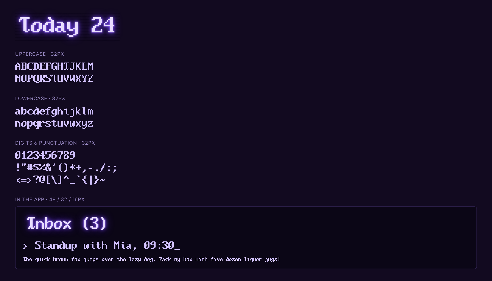

# Gothic Terminal

The app's own display font: a monospace pixel font with a blackletter feel, like an old computer terminal gone gothic. It's used for headings and the app name (`--font-display` in `web/src/styles/theme.css`).



## Design rules

- Every character sits in the same 8 × 16 pixel cell, like an old terminal.
- Vertical strokes are 2 px wide and horizontals 1 px. That thick/thin contrast is what makes it read as gothic.
- Round letters have broken corners (top left and bottom right), and capitals like T and I have hooked tops.
- One weight. It covers printable ASCII: A–Z, a–z, 0–9 and punctuation (95 characters).

One pixel is 100 font units (UPM 1600), so the font is sharpest at **16, 32, 48 or 64 px**.

## Files

- `glyphs.py`: every character, drawn as a text bitmap (`#` = pixel). This is the source to edit.
- `build.py`: turns the bitmaps into outlines and writes `dist/GothicTerminal-Regular.{ttf,woff2,woff}`.
- `specimen.html`: preview page with all characters, plus the optional CRT glow.
- `dist/`: the built font files. The app serves a copy from `web/public/fonts/`.

## Change a letter

1. Edit its bitmap in `glyphs.py` (every row must be 7 characters wide).
2. Rebuild and copy the web files into the app:

```bash
pip install fonttools brotli shapely
python fonts/gothic-terminal/build.py
cp fonts/gothic-terminal/dist/GothicTerminal-Regular.woff* web/public/fonts/
```

3. Open `specimen.html` to check it.

## CRT effect

Add `class="crt"` to any display text for the phosphor glow and scanlines (defined in `theme.css`).
